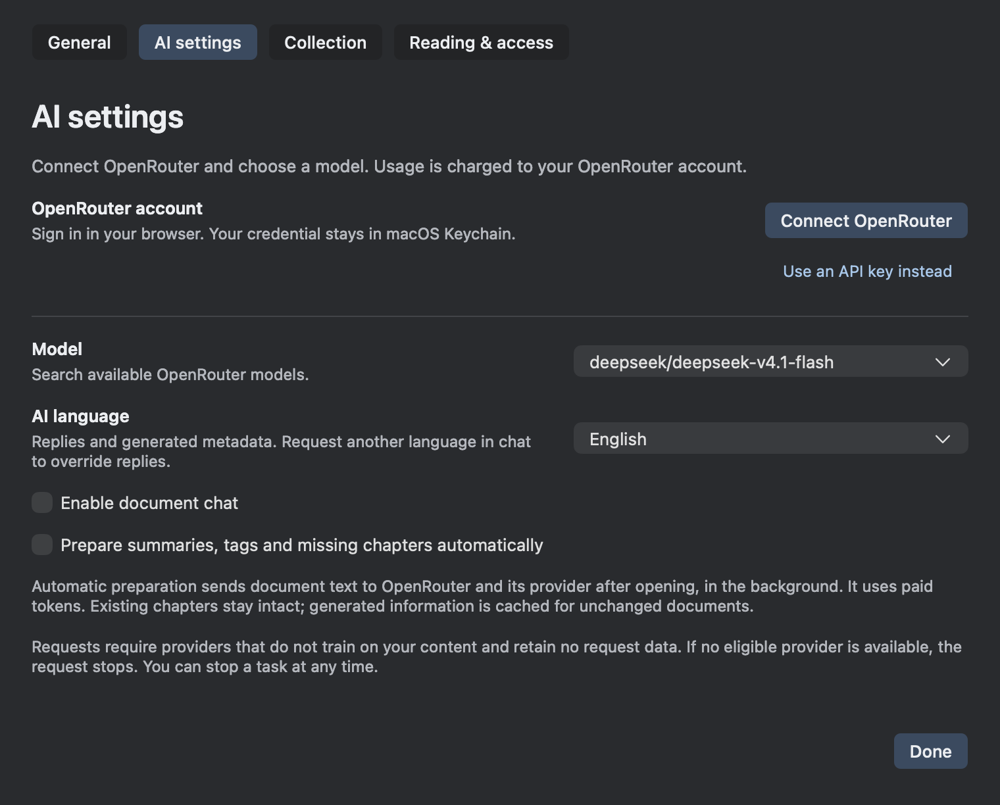
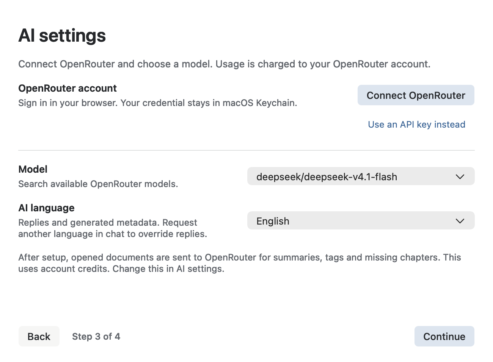
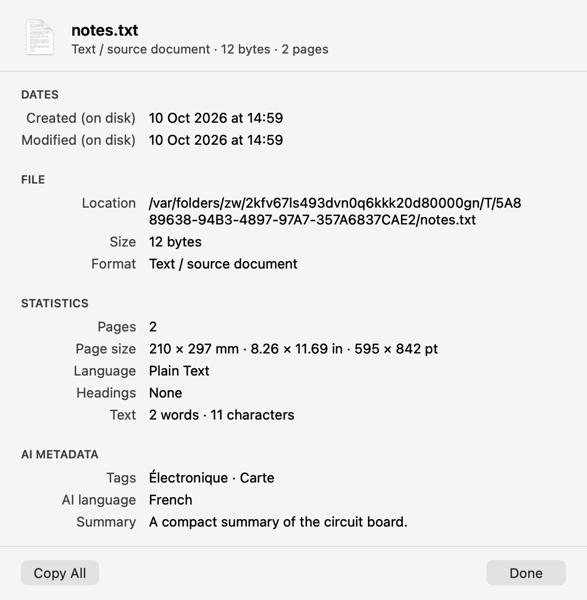

# AI language and document tags

10 October 2026.

## Behavior

Setup step 3 and AI settings share a searchable language dropdown. It searches
English and native names and persists a stable language code in ai-settings.yaml.
English is the initial default. Chat sends that default in its system instructions
on each user turn, while explicitly giving user language requests precedence.
Chat overrides do not mutate background preferences.

Each eligible background treatment sends one combined prompt for summary,
keywords, at most six distinct tags, and missing chapters. Generated text uses the
selected language; authored headings remain unchanged. There are no separate tag
or outline requests. The same combined response applies to incremental revisions,
which still use the prior metadata plus a bounded text delta when compatible.

Tags are trimmed, case-insensitively deduplicated, limited to six single-line
strings of at most 64 characters, validated before saving, and stored with the
summary in the existing versioned analysis cache. File Properties exposes cached
AI metadata without triggering analysis; document_metadata exposes it to chat.
Original files are unchanged.

## Cache and performance

Content/layout/model/language/prompt-version form the cache identity. Language is
also part of the incremental baseline identity. Settings changes cancel queued
analysis, clear visible stale metadata, and check the active settings generation
and output language before installing a result. Previously cached languages are
reused without a paid request. Only the current eligible document is scheduled
when settings change; others remain lazy until consulted. Older Collection
revisions, disabled AI, and unconnected/incomplete setup retain their existing
no-work guards. No extra startup scan or network request was introduced.

## Native visual evidence

All images are generated by headless AppKit test fixtures, not captured from the
user's running reader.

## Verification

- Settings: YAML round-trip and concurrent-window field merging; invalid language
  values rejected; construction remains disk/network inert.
- Chat: wire system instructions contain selected language and explicit user
  override precedence; existing persistence, cancellation and tool sequencing.
- Analysis: exactly one request produces all metadata; cache survives reopening;
  language change separates cached results and revision baselines; switching back
  reuses cache; stale-language publication is rejected; tag count/type/whitespace
  validation; existing two-process deduplication, delta, latest-only and no-work tests.
- UI: language search by native and English names; wizard/settings callback and
  state refresh; visible control corners hit correctly; light/dark native renders
  and narrow layout checks. Properties retains PDF/text/image-specific behavior.
- No live provider request or change to the running user app was needed.
