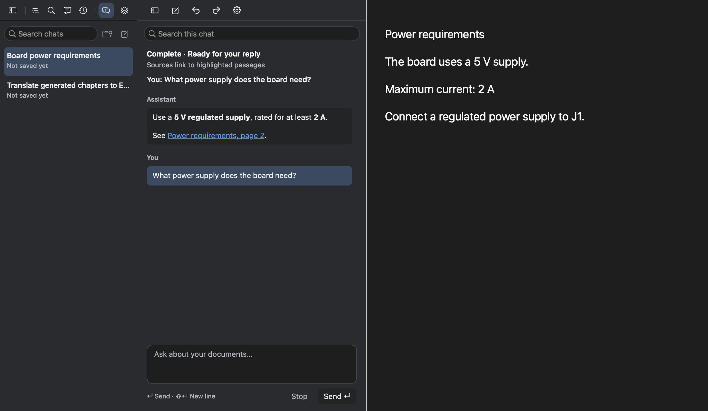
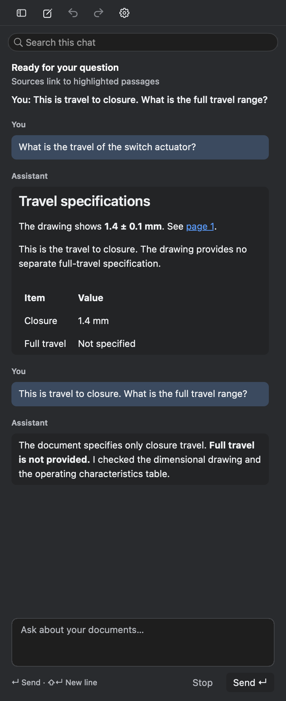

# Chat history and layout corrections — 10 October 2026

## Intent and organization

Readers need to return to a technical question without losing their document.
Keep one history sidebar beside the active chat, with the document to its right.
Use the reader's existing gray surfaces, blue selection, type sizes and vector
icons. The hierarchy is folder → conversation → message excerpt. Avoid another
navigation column, oversized cards, and repeated history controls.

The sidebar search finds titles and message text across saved chats. Each row
has a concise title and last conversation timestamp; message matches include a
highlighted excerpt. One-level folders can be created, renamed and collapsed.
Right-click chats to rename, move or delete them. Removing a folder explicitly
keeps its conversations in Unfiled. This is document-reader organization, not a
separate messaging application.

The active chat starts with a 36-point toolbar aligned to sidebar controls:
Hide, New chat, Undo, Redo, Settings. Its search filters this conversation only.
User and assistant messages retain distinct shades. Empty state is ordinary
readable helper text, with no empty transcript bubble.

## Findings and corrections

The previous visual check was an isolated fixture; its favorable assessment
missed the user's combined-layout problems. The new checks use layer-backed
native view hierarchies and the actual sidebar navigation control, both empty
and populated chat, narrow widths, and both themes. They do not capture, launch
or restart the user's application.

- The Chats navigation row was explicitly excluded from selected painting because
  it is a special navigation item. Its transient button state also reset on
  mouse-up. Selection now uses the persisted sidebar mode, with matching
  accessibility state.
- Chat actions were placed under redundant history search. Actions are now first,
  local chat search follows, and global history search remains in the sidebar.
- At the 12-step boundary the assistant had successfully changed chapters, but
  the session unconditionally reported an Error. It now allows one tool-free
  final response; if that cannot finish, an honest Paused state describes saved
  changes and remaining work. Metadata precondition errors now distinguish
  missing cached analysis from changed document revision.
- Generated chapter rows no longer add a sparkle. Prompts require plain,
  descriptive subject titles, preserving relevant technical terminology.
- New concise chat titles are suggested asynchronously after the first completed
  reply. They do not delay the response. Custom names are authoritative even if
  a model response or older window saves later.

## Persistence and performance

Conversation transcripts remain atomic per-chat files. A separately locked
organization file holds folder IDs, collapse state, custom names and suggested
names. A stale transcript cannot undo a move or rename. Deletion also removes
per-chat organization metadata; removing a folder preserves chats. Invalid or
oversized metadata is rejected without silently replacing the original file.

Store construction and history-state construction do no disk writes or model
requests. History search stays debounced on a utility queue; folder metadata is
read once per search. Chat-local search works on already loaded messages. Title
requests use bounded excerpts, are generation-guarded and cancel on switching
or beginning another turn. Folder/title changes do not resend the transcript.

## Review loops

First independent UX review: 8.4/10. Two medium issues were reproduced at 240pt:
long titles wrapped over timestamps, and wide-character preceding context could
hide a search match. Both were routed back for geometry and excerpt corrections.
The technical review found organization metadata surviving deletion, deletion
races and invalid nested metadata; these were corrected and covered by tests.

## Verification and limits

Native fixtures and deterministic transport replace the user's running app and
live provider requests. They verify view geometry, selection, toolbar hit areas,
search, persistence, conflicts, cancellation and the actual reader event path.
No claim of live-model or real-app click-through follows from these checks.

Final independent reviews: **UX 9.2/10**, **technical 9.2/10**, with no major or
medium findings remaining in the reviewed scope. Minor future refinement: give
truncated folder names a full-name hover tooltip, as chat titles already have.

The corrected row uses explicit one-line tail truncation and a reserved timestamp
line. Excerpts fit their leading context to the actual font width; a TextKit
regression verifies that a CJK search hit falls within the two visible lines.

## Native fixture evidence

The reading area below is placeholder document text in the production dock
fixture; it is not a screenshot of the user's open document.

Final checks returned exit 0: production-linked document-context, analysis and
chat-view acceptance; chat session, organization and history UI tests; transport;
sidebar navigation/workspace; workspace panel policy; launch-work policy; updater
(32 cases); source-size ratchet and whitespace checks. The old session failed
nine new boundary/title assertions; the corrected session passes. Provider
responses were deterministic fixtures, including distinct title requests.

## Reopening regression and chronological order

A subsequent user screenshot showed the underlying blank-bubble failure was
still present in populated conversations. An empty-state replacement did not
address that failure. A production-dock probe reproduced the missing lifecycle:
hide the chat (width becomes zero), then show the same cached conversation.

The message view measured at one point of available width and updated its height
constraint inside `setFrameSize:` while NSStackView was assigning cached frames.
On return, constraints recovered but child frames stayed thousands of points
high and outside the stack. The baseline failed 35 geometry assertions. Height
measurement is now deferred/coalesced until the current layout transaction ends,
skips hidden/zero-width views and caches measured width. The same lifecycle,
including three hide/show cycles, narrow/wide resizing and loading another chat
while hidden, passes with compact message frames and visible glyphs.

The user's revised order is chronological: older messages above, new replies at
the bottom. Opening a conversation and sending a question reveal the newest
message. Replies follow the bottom while the reader is there; scrolling up keeps
both the visible messages and their position. Loading older history prepends it
without moving the previous first message. Local search retains chronological
order. These behaviors have a separate long-conversation regression fixture.

This image is a native offscreen fixture, not a capture of the running app.
Final chat-view, document-context, analysis, session, sidebar, launch-policy and
updater checks passed, alongside source-size and whitespace checks. Independent
code review found no blocking or medium issues in the corrected lifecycle and
scroll behavior. No live provider request or user-app restart was used.
