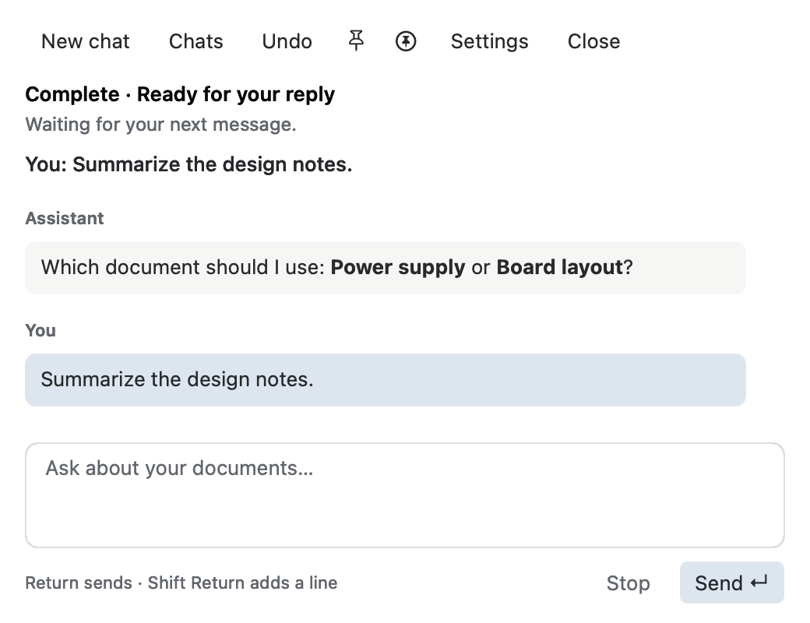
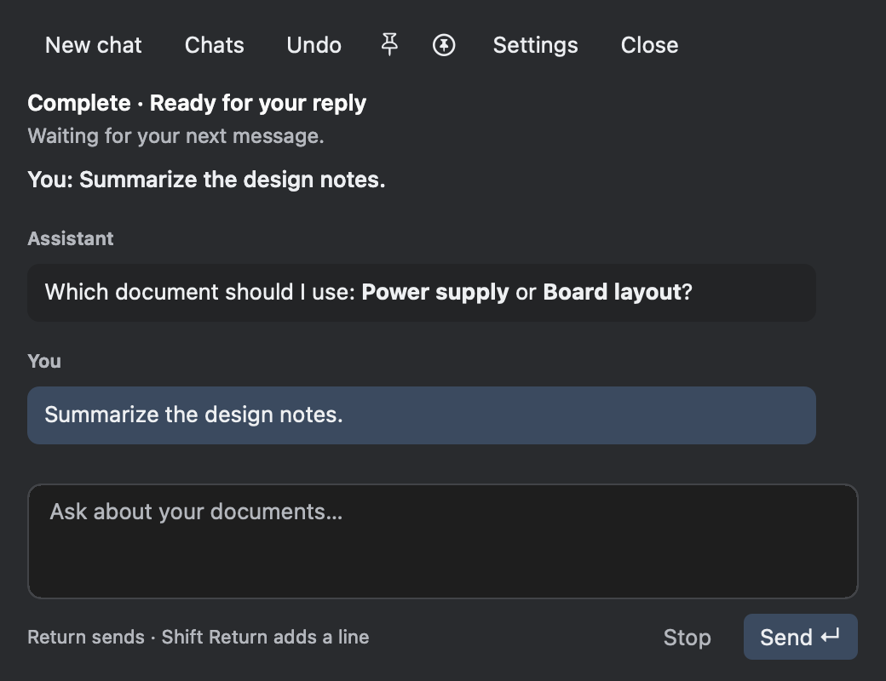

# Collection rename and distinct chat messages

10 October 2026.

## Report and cause

The assistant refused to rename a writable Collection copy because the AI adapter
explicitly rejected that document type, even though the native tab menu already
supported it. The adapter now uses the same Collection transaction, rather than
moving the underlying content blob or creating another document.

The original source reference, group, file bytes and version history are preserved.
Undo records the previous working filename and the separate Collection title.
It checks copy identity, revision, name conflicts and a transaction-protected title
before restoring either; a later human rename is never overwritten.

The model system prompt now requires the shortest useful reply unless detail was
requested, close adherence to the user's specifications, and performing available
actions instead of explaining how the user could perform them.

## Message design

User messages use the existing muted blue selection color; assistant messages use
the existing neutral control shade. Both retain role labels, selectable text and
clickable citations. Rounded backgrounds have 10-point horizontal and 8-point
vertical padding, included in text measurement so wrapped lines remain visible.

## Verification

- Production-linked document-context suite: rename through the actual AI tool,
  automatic extension preservation, same tab/group, original/history/byte
  preservation, exact title/filename Undo, cancellation, stale revisions,
  destination collisions, title conflicts and refusal after a later human rename.
- Chat-session suite: actual transport payload contains the requested behavior
  instructions; existing immutable-message, cancellation and persistence checks.
- Native offscreen chat suite: separate shades in both appearances, narrow-window
  wrapping, citation glyph hit targets, all header/footer controls, pin toggles,
  send/draft retention and minimum-height layout.
- Collection store, integrity and cleanup suites: existing native rename and
  storage behavior remain covered.
- All listed suites exit zero. No document-opening or launch work was added.
  The live user app was not launched, quit or captured. The images above come
  from the offscreen native test fixture. No live provider call was needed.
