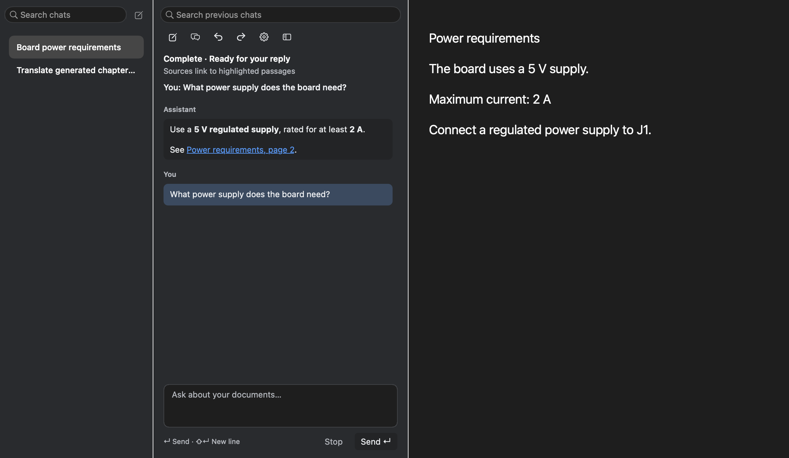
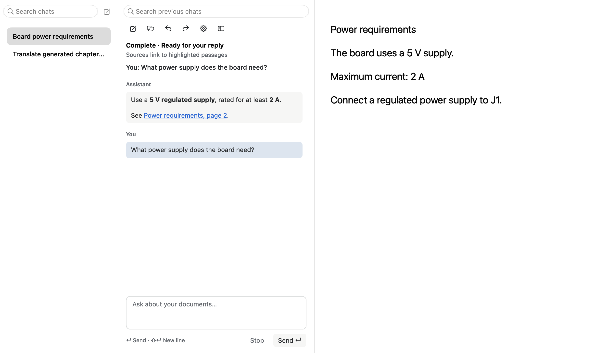

# Docked chat and app access — 10 October 2026

## Requested behavior

The confirmed arrangement is **history sidebar + chat panel + document**. The
Chats icon belongs to the existing left navigation. Selecting a saved chat, or
opening chat through empty Cmd-K / Return, exposes a resizable panel beside the
reader. Hiding the panel preserves the conversation and draft. Saved transcripts
remain available after relaunch. The separate chat window and pin controls are
superseded by this arrangement.

## Implementation decisions

- A lazily constructed nested split hosts chat beside the existing document view.
  The reader's rendering, selection, toolbar, and map remain intact. Width is
  stored in the per-window YAML sidebar state. Compact layouts temporarily yield
  navigation/map space without replacing their saved preferences.
- History is a sidebar mode, not a second transcript view. Title/message search
  runs off the main thread after a short debounce; both search fields share the
  same query. Merely creating history state starts no transport/session/chat UI.
  Hidden history does not enumerate saved transcripts on sidebar rebuilds.
- New/load/switch preserve independent copied draft strings within the session.
  The store continues to save both speakers and tool evidence. Selecting an old
  chat resumes it; deleting one or all still asks for confirmation.
- Header actions use fixed-ratio native vector symbols and full 28-point targets.
  User and assistant messages retain distinct background shades. Return sends,
  Shift-Return adds a line, IME confirmation never submits prematurely, and
  Escape from the composer hides chat. Empty-composer Cmd-Z/Shift-Z controls agent
  Undo/Redo only while the composer has keyboard focus.
- `update_document_metadata` modifies real cached generated chapters, summary,
  keywords, tags, and language. Validated pages and revisions are retained; file
  contents and authored outlines are unchanged. Explicit language edits survive
  normal default-language filtering. Exact metadata receipts support Undo/Redo.
- Native `app_controls` extends discovery to app menus and visible controls.
  Secure/credential fields, hidden ancestors, and stale targets are excluded.
  Native commands are queued into the run loop so a modal dialog cannot prevent
  subsequent inspection. The result reports queued dispatch, never completion.
  Generic native actions explicitly have no journaled Undo; typed edits do.
- Action Undo/Redo checks relevant current state. Mixed metadata/file sequences
  recognize exact restored PDF bytes after an atomic replacement changes the
  inode; hashing occurs on the worker only when needed, within the existing
  32 MiB file-edit budget. Conflicting human edits are preserved.

## Review and corrections

The technical review initially scored 6.5/10 and identified mutable draft aliasing,
eager chat initialization, missing resize policy, and keyboard selection routing.
Those were corrected and tested. A later mixed-history Undo failure was reproduced
before its fix. Final technical review: **9/10**, no remaining actionable blocker.

The UX reviews identified premature IME submission, indistinguishable disabled
icons, sparse history rows, mismatched fixture backgrounds, uppercase Redo, and
keyboard-focus ownership. Corrections added 36-point centered history rows,
consistent surfaces/separators, subdued disabled controls, and focus-aware
keyboard handling. Final visual/interaction assessment: **9/10**. Its acceptance
caveat exposed a width-restoration failure: global mouse-button state incorrectly
classified programmatic layout as dragging. Tracking the split's own divider
mouse gesture fixed the failure; hide/show now retains the chosen width.

## Native visual evidence

These are offscreen AppKit fixtures using the production history, chat and dock
views. The right-hand document text is a layout fixture, not a capture of a real
reader document. The running user app was neither launched nor captured.

## Verification

- Production-linked AI reader acceptance: actual Return event routing through
  composer/session/fake transport, Shift-Return, Escape, saved-chat continuation,
  independent drafts, citations/highlights, Collection rename, real metadata
  edits, conflicts, cancellation, mixed Undo/Redo, and no-work discovery.
- Native chat tests: light/dark rendering, reflow, fixed symbol ratios, full button
  corners, IME confirmation, focus-aware uppercase Cmd-Shift-Z, dock resize and
  hide/show, keyboard history opening, title/both-speaker search, and store reopen.
- Native app-control tests: bounded inspection, secret/hidden/stale exclusion,
  choice/text callbacks, dispatch-only results, and modal-loop responsiveness.
- Chat/session, transport, sidebar navigation/workspace, workspace panel budgets,
  launch-work policy, updater tests, source-size ratchet, and whitespace checks.
- Provider traffic was replaced with deterministic test responses. No live-model
  success or real-app click-through is claimed by these checks.

## Remaining scope boundaries

Unsent drafts and action journals are session-local. Saved conversations persist.
Metadata edits require existing cached analysis and valid evidence coverage.
Native menus retain their ordinary confirmations, OS permission requirements,
and cancellation behavior; they cannot all be reversed by the assistant journal.

Final headless runs returned exit 0: AI reader/analysis/chat view acceptance,
chat session and transport, sidebar navigation/workspace, workspace panel budget,
launch policy, and 32 updater cases. The split-local divider regression now proves
that programmatic layout cannot change the saved width and real divider tracking
can. File-size and whitespace checks also passed.

A final performance check removed per-frame YAML writes during divider dragging.
Geometry remains immediate; a 200 ms settling debounce saves only the final width.
The production-linked composer fixture verifies three width changes cause zero
synchronous writes and one eventual save containing the final value. Context
acceptance passed again after this change.

## Follow-up correction

The user's subsequent screenshots exposed combined-layout faults that the
assessment above missed. See [the corrective journal](chat-history-and-layout-corrections.md)
for the more representative layered fixtures, root causes and follow-up review.
