# Document assistant implementation journal

Status: implementation complete; final build, focused tests and interactive verification passed. No release has been published.

## Clarified request

Build a native document assistant reached by Command-K then Return on empty search, while preserving normal search-result activation. Keep chat in the command-palette surface, newest messages first, with Markdown, clickable evidence and trusted document-page images. A Chats control beside Groups opens saved conversations, new-chat and deletion controls.

Connect the reader's own OpenRouter account through browser authorization or an optional Keychain-backed API key. Default to DeepSeek v4.1 Flash. Enforce no-training and zero-retention provider routing for every inference request; do not silently relax it when no endpoint is available. Cloud analysis is a separate explicit opt-in.

Prepare cached document summaries, keywords and generated chapters only when authored chapters are absent. Retrieve in stages: workspace groups and titles, available analysis/outline, matching passages, exact pages. Respect the actual text-document pagination and source revision. Generated information is separate from the original document.

Expose structured reader tools with explicit parameters and reversible adapters. Stop cancels future work; Undo reverses completed mutations only when their affected state has not changed independently. Do not expose arbitrary selector execution or shell access to the model.

Consolidate first-run prompts into one friendly, reopenable native settings window. A versioned discovery marker shows the new experience once to existing users in the next release; an optional preference shows it every launch. Preserve the updater lifecycle and avoid work before first paint.

## Team and verification plan

- Architecture/tool agent: hierarchy, document evidence, comments/groups, Undo, live text layout.
- Connection/analysis agent: OpenRouter transport, OAuth PKCE, Keychain, YAML settings, lazy background preparation.
- Experience/design agent: first-run brief, native settings, rich chat, headless interaction probes.
- Parent: integration, persistence, palette semantics, settings effects, regression checks, actual isolated user-path validation.
- Independent technical and UX critics: at most four review loops, ranked actionable findings and honest scores. Target at least 9/10 after fixes and evidence.

The user authorized at most $25 in live provider tests. Offline fixtures remain the primary verification. No pasted key is in source, fixtures, notes or logs. No live authenticated provider call has been made yet.

## Decisions and evidence

The first native Settings implementation passed section layout and full-bounds mouse-event probes in light and dark appearances. Constructors do not access credentials or the network. OpenRouter transport tests verify cancellation, strict privacy routing, bounded payloads, OAuth callback state/PKCE, settings merging and zero constructor side effects.

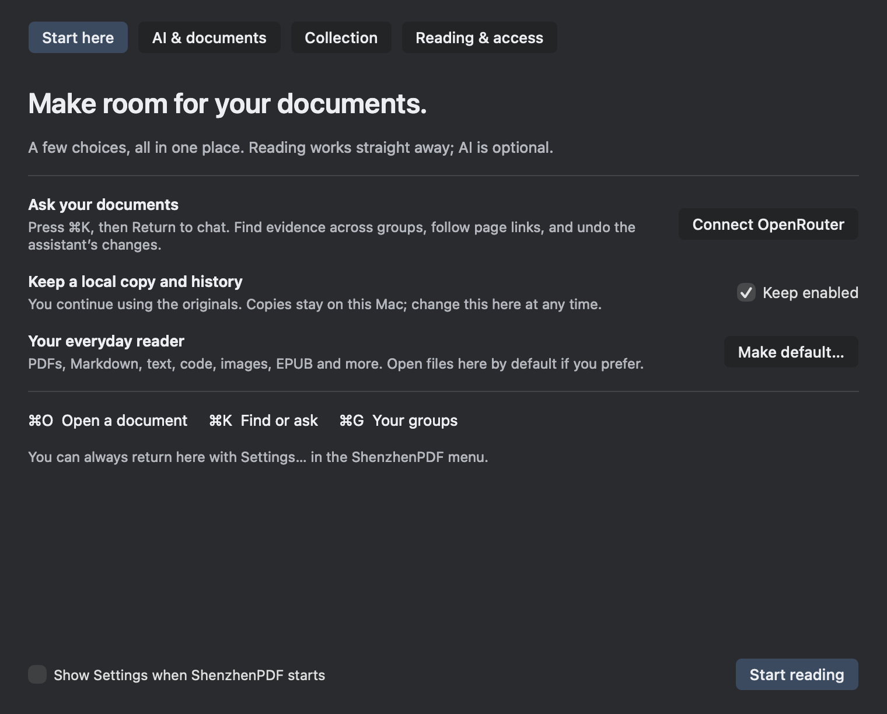

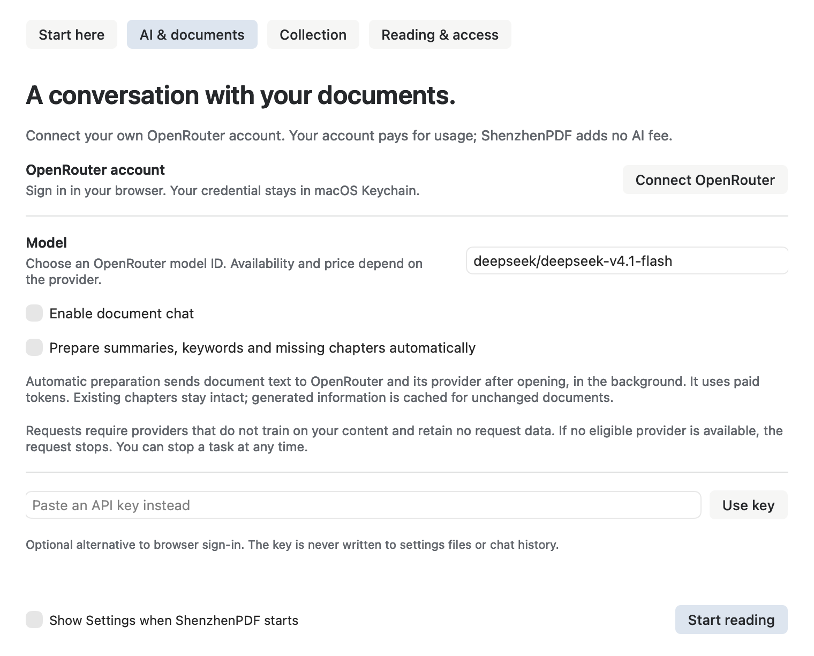

Chat orchestration serializes tool calls and rejects malformed provider JSON before any action. Cancellation advances a generation; late replies cannot apply actions. Chats use private local atomic files. Deletion writes tombstones so stale windows cannot resurrect a removed conversation. Document previews are copied into owned chat assets and excluded from model tool output.

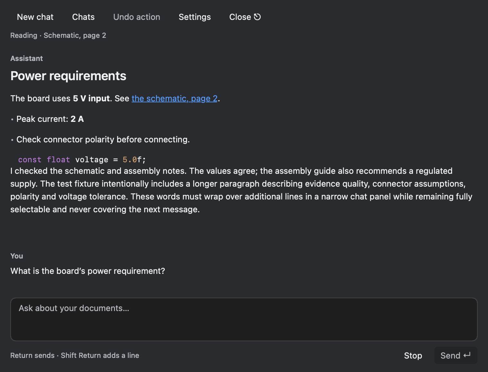

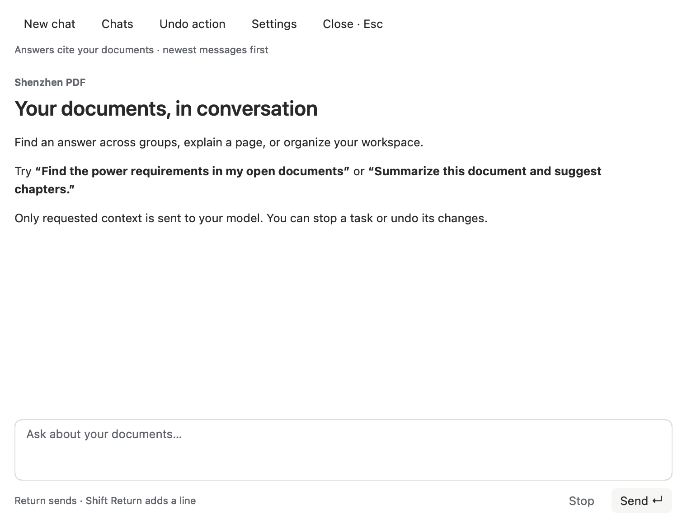

The first technical critic scored 5/10 and found actionable integration defects, including citation type mismatch, malformed tool-call crashes, incomplete cache identity and deletion semantics. The first UX critic scored beauty 8.2/10 and usability 6.8/10. Fixes are being verified; these are not final scores.

Production-linked document tests cover exact PDF snippets, page bounds, cancellation, generated chapter validation, live Markdown typography/landscape, same-source caching, comments with exact-byte Undo, cancellation during native permission handling, empty-group restoration and opaque document IDs.

Foundational session/transport tests, sidebar navigation, launch-work policy, and 32 updater cases passed. Full app integration build succeeded before the latest review fixes; it must be rebuilt and revalidated after integration stabilizes.

## Remaining validation

Finish complete cache identity/cross-process deduplication, generated-outline integration, additional reader control adapters, review-loop fixes and production user-path tests. Verify the real app in an isolated state directory using the user's explicit authorization, leaving their existing instance and tabs untouched. Record build/test exit codes and any limitation before final delivery; do not claim all human actions or live AI behavior without evidence.

## Third review and interactive verification

UX loop 3 rates the reviewed native surfaces 9.0/10 for beauty and usability. It identified keyboard focus after leaving history, secure-key Return routing and close-time OAuth cancellation; all three received targeted fixes. A final rebuilt-app pass remains necessary.

An isolated copy at `/tmp/szpdf-ai-validation/ShenzhenPDF AI Validation.app` was launched through computer use with a separate `SPDF_STATE_DIR`. The original app/session was not touched. Verified real paths: first-run Settings, AI section, explicit Collection opt-out, Start reading, native Open dialog with a disposable Markdown fixture, Command-K, Return to new chat, question entry, disabled-chat guidance, closing Settings, Chats, and returning to the exact preserved unsent question. The copied build predates the newest focus fix, so its history-return focus failure is recorded rather than counted as passing.

OpenRouter's public model catalog was queried without credentials and confirmed `deepseek/deepseek-v4.1-flash`, tool support and the provider-reported model metadata. No authenticated inference has run and no credits have been spent. The user has been offered the new connection flow for live testing; offline fixtures continue independently.

Analysis repair tests pass including two independent processes sharing one analysis request, model/layout/dependency cache invalidation, disabled zero-work behavior, opt-out during queued work, and rejection of stale generated chapters. See [analysis cache evidence](analysis-cache-validation.md).

Foundational transport/session/model/Settings/sidebar/launch-policy/updater tests returned exit 0. Chat storage now rejects malformed saved actions, completes interrupted action/result pairs as cancelled without replay, locks preview saves against deletion, and removes owned temporary preview directories on rejection. Tested change sets were committed separately.

A second isolated native build pass confirms: relaunch restores the fixture tab without repeating first-run Settings; Chats → Return to current chat immediately accepts typing in the preserved draft; New chat clears the old draft and accepts typing; Return in the secure key field invokes validation, keeps Settings open and clears the invalid test input. No credential was stored for that test.

The broader Markdown/Collection runner exposed two stale test-harness contracts from the earlier editable-Collection change: its explicit source list omitted `CollectionStoreEditable`, and old assertions required read-only archived previews. The runner now includes the complete Collection store source family, and its open-copy assertions require an independent writable Collection copy while stored snapshots remain immutable. The full runner is being rerun; this is distinct from the new AI test results.

## Final integration evidence

Technical review loop 2 reached **9/10** with no remaining major or medium findings. UX review loop 3 reached **9/10** for both beauty and usability. The notes above retain earlier failures to document what the reviews caught, rather than retroactively treating those builds as passing.

Two authenticated checks subsequently passed using the production OpenRouter client and **synthetic text only**. The real DeepSeek model called a document-reading tool and answered with the fixture's 240 RPM value. A separate production AnalysisService test returned a summary, keywords and four generated chapters, then reused the cache without a second credential read/request. Three model requests were made in total, within the authorized $25 budget; exact account billing was not read. The key was supplied through hidden terminal input, never written to source, fixtures or command-line arguments, and not installed in the app's Keychain. Browser OAuth has protocol tests, but was not completed against a real browser account during this verification.

The full Markdown/Collection integration runner passed after correcting its stale editable-copy and history-sidebar test contracts. The separate production-linked AI reader and document-job suites passed. Transport, chat persistence/concurrency, settings, model validation, sidebar hit targets, launch-work policy and updater tests also returned exit 0.

A final scalability check found that workspace discovery must stay metadata-only. It now pages groups and document titles independently (50 by default, 100 maximum); the assistant requests cached analysis and chapters separately with `document_metadata`. A 1,000-document/group fixture produced a 16,964-byte first response with **zero file-stat, document-candidate or analysis reads**. This avoids turning a simple workspace question into work on every open file.

The shared Markdown parser now records two source metadata stamps around its existing asynchronous parse. These stamps prevent a visible old layout from being cited or analyzed as if it came from a newer disk revision. A local warm microbenchmark measured 4.821 microseconds per pair; this is not a whole-app launch benchmark. With AI disabled, no AI queue, cache, hashing, Keychain lookup or network activity is started.

Citation navigation is restricted to evidence actually returned by tools in the conversation and the current source/layout revision. Successful explicit citation clicks close the palette to reveal the cited page; stale evidence reports an error. Chat persistence rejects stale concurrent overwrites and deletion resurrection. The final app rebuild includes these safeguards.

## Final native user paths and regression record

In the rebuilt isolated app, loading the saved offline evidence conversation focused the composer. Clicking its tool-issued citation closed chat and revealed the cited page. A nonempty Command-K query followed by Return still opened the selected document; clearing the query and pressing Return opened a fresh chat. Shift-Return inserted a line without sending. Settings reopened from chat and retained the unsent draft.

The real OpenRouter browser authorization page opened with the expected local callback, PKCE challenge and app label. Choosing **Deny** exposed a stuck Connecting state in the original implementation. OpenRouter explicitly omits state/code on denial ([provider contract](https://openrouter.ai/docs/guides/overview/auth/oauth)). The callback now treats an empty request to this attempt's exact random path as cancellation only: no token exchange and no credential write. Forged states and unrelated browser requests cannot consume the attempt. Cancellation resets Settings without an error sheet. A socket-level regression reproduces the actual redirect and passes; successful account authorization remains protocol-tested rather than browser-approved.

Final recorded checks (all exit 0):

| Check | Evidence |
|---|---|
| Production context, analysis, chat-view and document-job acceptance | `make -C portable -j4 mac-ai-reader-tests mac-ai-document-job-tests`; `/tmp/ai-final-verified.log` |
| Full Markdown / Collection runner | `portable/mac/tests/run-markdown-integration-tests.sh`; `/tmp/ai-markdown-regressions-history.log` |
| OpenRouter transport, PKCE, cancellation and denied callback | `make -C portable mac-ai-transport-tests`; `/tmp/ai-oauth-denial-tests.log` |
| Shortcut help, including the new chat entry | `make -C portable mac-shortcut-help-tests`; `/tmp/ai-shortcuts-final.log` |
| Settings, sidebar, launch policy, updater and model checks | `/tmp/ai-regressions-final.log`, `/tmp/ai-settings-final.log` |
| Chat concurrency and persistence guards | `/tmp/ai-concurrency-tests.log` |
| Source size and whitespace checks | `tools/check-file-sizes.sh`, `git diff --check` |

Technical review loop 3 retained **9/10**, closing the selected-document metadata and pathological Unicode size findings. No extra paid model calls were required for these fixes. The updated guide and release preview separate reader features from AI controls and document bounded search/analysis, local-job dependencies and guarded Undo limitations.

The final application build (`make -C portable -j4 mac-app`, `/tmp/ai-final-app.log`) returned exit 0. Repeating the real browser Deny flow in this binary displayed “Connection cancelled” in the browser, restored the Connect OpenRouter button in Settings immediately, and showed no error sheet. Command-comma also reopened Settings correctly. The private validation instance was kept separate from the user's saved workspace throughout.

The finished build is `dist/ShenzhenPDF.app`. It is a local ad-hoc-signed development build, not a notarized public release. Reader and AI release notes are prepared separately in `portable/docs/releases/ai-reader-preview.md`. Browser account approval was not performed; live model inference was verified with the separately authorized test credential and synthetic content. Normal use starts by connecting the account in Settings.

## 10 October 2026 — setup and revision context

The current first-run path is a four-step Settings wizard shown after the reader
is ready: Full Disk Access, Collection, OpenRouter, and per-format default
reader choices. Full Disk Access is optional and macOS can request it later;
the wizard has no Accessibility step. Collection can use a dynamic allowance
of up to 80% of free space plus existing Collection storage, a fixed storage
limit, or Unlimited. The OpenRouter API-key field is revealed only when chosen;
opening the model picker loads a searchable catalog filtered to tool-capable
models. Finishing setup closes the wizard back to the reader and does not make
Settings recur at every startup.

New installations default document chat and automatic analysis to on, while
existing saved preferences are preserved. The defaults do not authorize a
request by themselves: cloud chat and analysis require completed setup and a
connected OpenRouter account. The setup text explains the document text sent
for summaries/missing chapters and the use of account credits.

Automatic Collection analysis applies to the current/latest source. Immutable
historical previews and editable copies attached to older saved revisions do
not receive separate automatic summaries. When a latest revision is compatible
with its saved analysis baseline, the provider receives the previous analysis
and a bounded text delta (up to 32,000 changed UTF-16 code units); it does not
receive the full excerpt again. Incompatible page coverage, outline, layout, or
change size uses the existing bounded excerpt path.

`document_metadata` lists Collection revision identifiers, dates and file
sizes from manifest metadata without reading archived document bytes. Passing
an explicit `revisionID` lazily computes a text-only comparison with the
preceding revision from saved indexes. It compares at most 30 pages and
128,000 combined text characters, with a 4 MiB limit per index, and marks the
result partial. It does not measure image changes or full-file byte changes;
missing, encrypted or oversized indexes return an unavailable reason. See
[revision analysis validation](revision-analysis-validation.md) for the source
validation record and bounds.

### Setup validation and critic loop 2

The native wizard now uses a compact, stable four-step layout. Browser connection
is the primary action; the API-key alternative is secondary and expands only
when selected. Connection transitions replace obsolete controls, while status
updates preserve an API-key draft. Invalid static capacity values retain the
previous limit and show an inline correction rather than silently changing the
cleanup budget.

The following are headless renders of the actual AppKit controller, not HTML mockups.

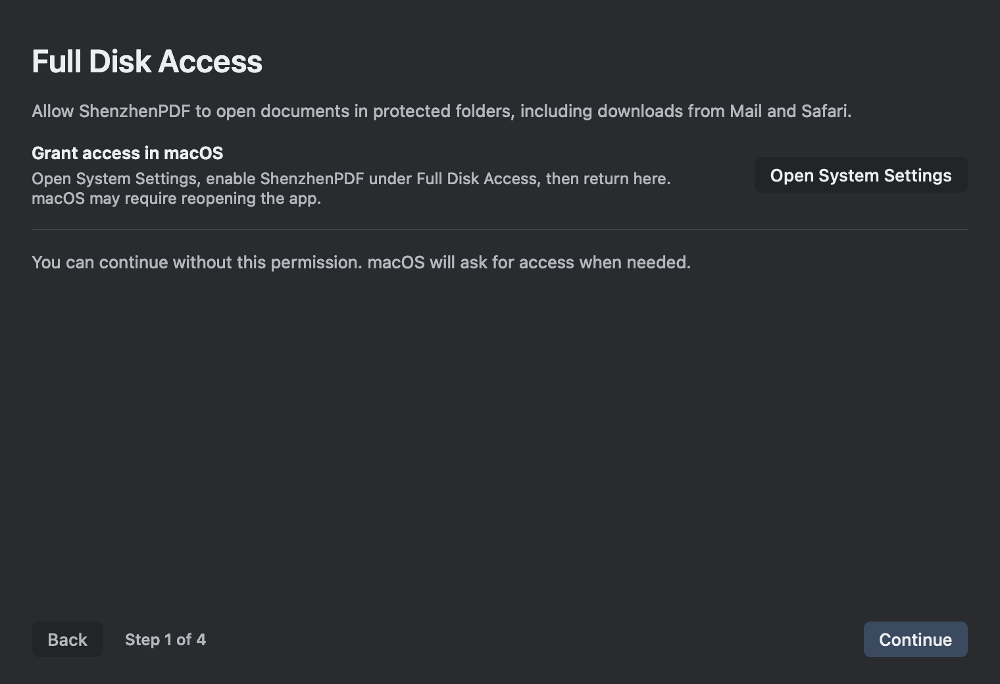

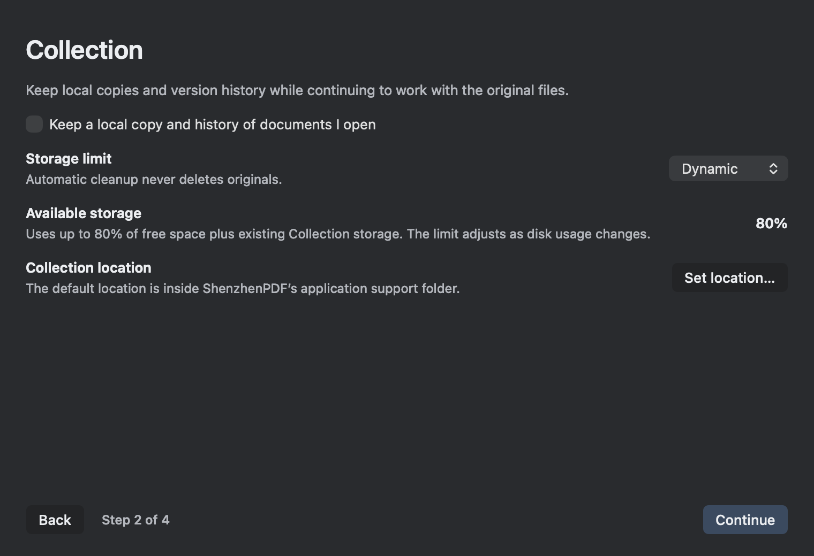

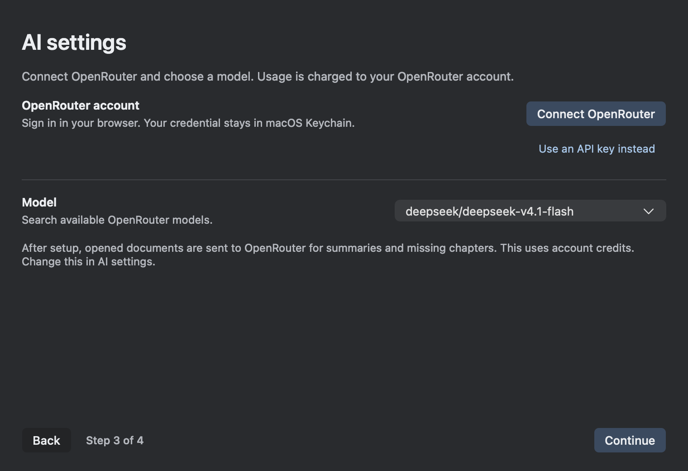

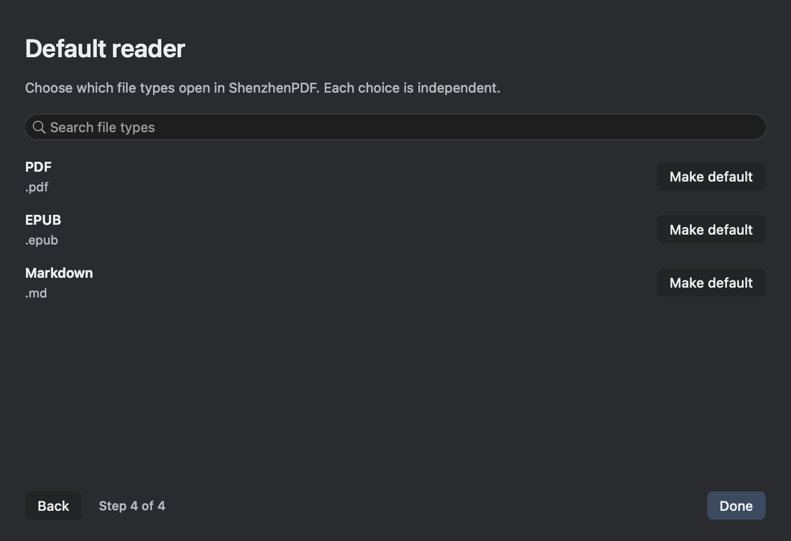

Independent review after two refinement loops reached **9/10 technical,
9/10 usability and 9/10 visual craft**, with no major or medium findings left.
See [technical review](technical-critic-setup-loop-1.md) and
[UX review](setup-rewrite-critic-loop-2.md). The review caught and closed stale
latest-revision analysis across cache waits and other reader processes, plus
Unicode clipping at text-budget boundaries. Revision notifications are scoped
to the Collection root; unrelated test stores do not invalidate user summaries.

Fresh successful checks (real exit codes):

| Check | Evidence |
|---|---|
| Full AI reader acceptance, latest-only lifecycle, lazy revision diffs and Unicode | `/tmp/ai-revision-lifecycle-verified.log` |
| Setup, model catalog, connection gates and YAML progress | `/tmp/setup-final-build-verified.log`, `/tmp/sz-settings-loop2-tests.log` |
| Collection capacity, store integrity and cleanup | `/tmp/setup-final-collection-tests.log` |
| Updater (32 cases), launch-work policy, state YAML and chat | `/tmp/setup-regression-checks.log` |

Native interaction in a separate test workspace verified all four steps,
live catalog loading and model-name filtering, keyboard selection, Done returning
to the reader, and reopening Settings with both AI defaults enabled. No system
file associations or privacy permissions were changed during validation.

The final native run also verified a completed setup stays dismissed after
relaunch, and a saved incomplete setup resumes at Collection (step 2). Static
storage rejects `oops` without changing its prior 10 GiB limit. The production
file-type list includes 16 formats; searching `.pdf` leaves only PDF.

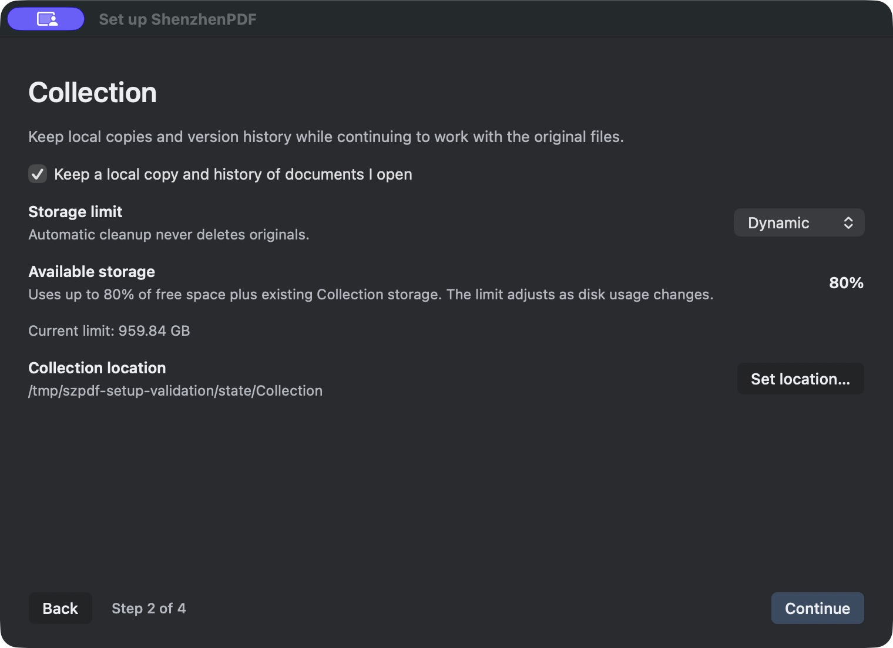

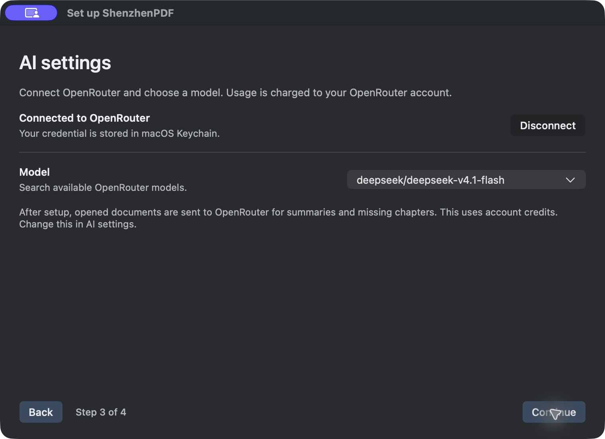

A rapid storage-mode change followed by Continue exposed one additional
reentrant callback race: the footer advanced but a stale callback repainted the
Collection page. The native controller now tracks page generations so a late
storage callback cannot replace a newer page. A regression reproduces the old
failure with a real synchronous host callback and checks navigation to both the
AI wizard step and an ordinary Settings section.

The reentrancy regression is independently verified in the technical review;
all three 9/10 grades stand. The final footer accessibility check also verifies
that assistive technology sees “Continue” on steps 1–3 and “Done” on step 4,
matching the visible button. Final focused results are recorded in
`/tmp/sz-settings-footer-accessibility.log` and
`/tmp/spdf-critic-setup-reentrant-final.log`.

Final delivery build: `make -C portable -j4 mac-app` exited **0**
(`/tmp/setup-final-delivery-app.log`). In that exact build, rapidly choosing
Static + Continue and then Dynamic + Continue both landed on the AI page with
Step 3 displayed, closing the reproduced UI race. Done returned to the reader.
The app in `dist/ShenzhenPDF.app` is the resulting local development build;
no notarization or public release was performed for this batch.

## Storage and credential follow-up — 10 October 2026

Settings status now uses the saved connection flag instead of reading a Keychain
secret during launch. All AI and Collection Keychain operations explicitly
disable authentication UI, including the legacy Keychain ACL path. A locked or
denied key fails without a password dialog; key storage remains protected by
Keychain. Signed releases retain their stable signing identity.

The Collection step explains the two storage modes in one line: “Dynamic adapts
to free space; Static uses a fixed size.” A native slider selects 50–80%, default
80%, with a numeric readout. The value persists through mode changes and is
available in both setup and Collection settings. Default-reader choices remain
available from Settings → General → Choose file types….

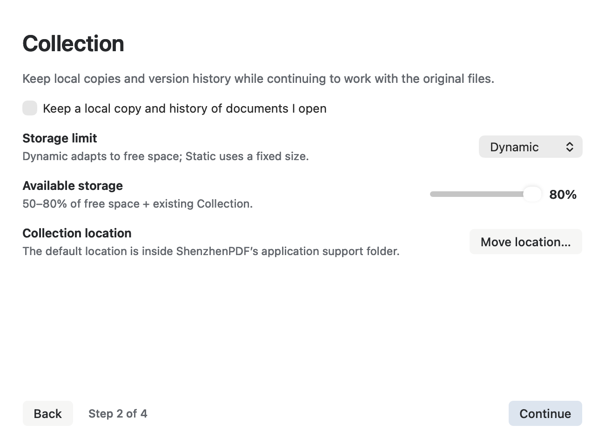

This is a headless render of the native controller at its narrow size. The
unchecked Collection box belongs to the test fixture; the production default
remains enabled.

“Move location…” transfers verified content and removes the old stored payload,
including indexes and thumbnails. Small routing records keep saved tab paths
working. Independent review caught a late-save race in the initial copy/delete
approach; the move implementation preserves editable file identity on the same
disk. Cross-disk moves with editable documents are refused rather than risking
loss of a concurrent save. See [move validation](collection-move-validation.md).

Focused settings, credential, ordinary-document Keychain laziness, launch policy
and updater regressions pass. The updater suite still passes all 32 cases.
The final Collection Store, Integrity and Cleanup suite passed with exit 0
(`/tmp/collection-move-lossless-final-verified.log`). Independent UX review of
the native narrow render and source rated visual quality and usability 9/10,
with no medium findings; a minor default-reader subtitle mismatch was corrected.
Settings tests then passed again (`/tmp/storage-settings-copy-final.log`).
The relocation review reached 9/10 for its supported scope; see the
[technical review](technical-critic-storage-follow-up.md) for resolved findings
and recovery limits. The associated AI fix preserves latest-only analysis for
restored old paths and learns moved roots lazily. Production-linked regressions
passed (`/tmp/ai-relocation-alias-final-tests.log`), including disabled-AI laziness.
Final delivery build: `make -C portable -j4 mac-app` exited 0
(`/tmp/storage-followup-delivery-app.log`), followed by successful deep strict
code-signature verification, whitespace checks and the file-size ratchet
(1,333 maintained source files, 34 exact caps). The resulting development app is
`dist/ShenzhenPDF.app`. No user app was restarted and no public release was
performed for this follow-up.

## 10 October: docked chat and native app access

The confirmed history-sidebar + chat-panel layout replaces the earlier floating
window design. Implementation decisions, critic findings, native fixture images,
and verification are recorded in [Docked chat and app access](docked-chat-and-app-access.md).
