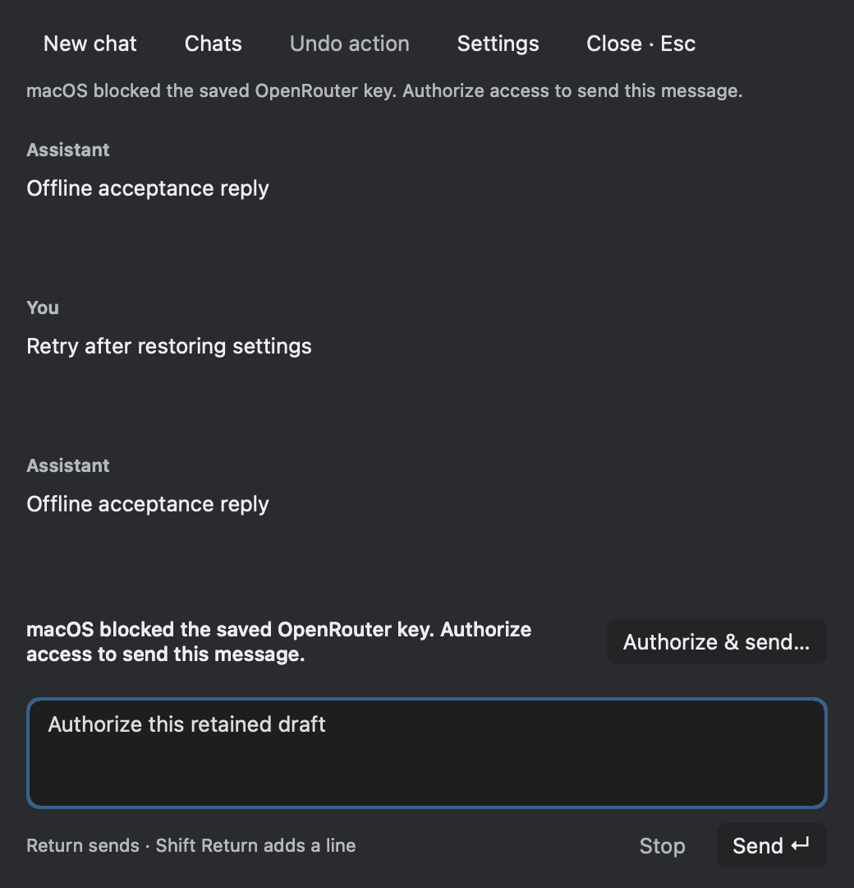

# Return-to-send regression — 10 October 2026

The user reported that Return opened Settings instead of sending their message.
The saved non-secret state had setup revision 2, chat enabled, and
`connection_configured: false`. The send handler treated that display flag as an
authoritative gate before checking the saved credential. Setup completion also
unconditionally rewrote the flag from a Keychain read, allowing a transient
failure to erase an established connection.

The actual composer Return handler now reaches the send handler, which checks
setup and the chat toggle, then tries the saved credential noninteractively. A
usable credential repairs a stale connection flag and sends normally. A missing
or denied credential shows an inline explanation while preserving the draft and
conversation. Settings opens only when the user chooses it. Shift+Return remains
a newline. Finishing setup never re-reads an already configured connection.

The earlier tests covered composer submission and transport separately; that
missed the production host gate. The new regression joins the real composer key
event, reader host, session and URLSession to an intercepted offline provider
reply. It covers stale and valid flags, denied/missing credentials, retained
drafts, retry, disabled/setup gates, and empty Cmd+K Return routing. Provider and
Keychain access are faked; no user documents or keys are sent in these tests.

Evidence: production context acceptance, `/tmp/ai-composer-acceptance-run.log`;
chat session, `/tmp/ai-return-chat-session.log`; native chat view,
`/tmp/ai-return-chat-view.log`. These exited 0. Wizard host tests also cover zero
credential reads for an established connection and adoption of legacy keys.

A noninteractive metadata-only query confirmed that the user's saved OpenRouter
item exists. Its decrypt ACL contains trusted records for earlier rebuilt app
paths. No credential data was read; compatibility of the current app with that
ACL remains unverified. This delivery uses the existing stable Developer ID
identity rather than an ad-hoc signature. That prevents future identity churn;
it cannot bypass an old ACL denial, which may require one explicit reconnect.

No running app was launched, quit or screenshot for this fix. Native UI tests
run headlessly. No live OpenRouter request or public release was performed.

Final combined acceptance (including wizard and palette routing) passed at
`/tmp/ai-composer-palette-routing-run.log`. Test-header dependencies are now
tracked so an edited regression header cannot leave a stale test object.
The delivery build exited 0 (`/tmp/ai-return-delivery-build.log`), and deep strict
code-signature verification passed with the stable Developer ID designated
requirement. Output: `dist/ShenzhenPDF.app`.

## Follow-up: the saved credential is blocked

The user still saw no reply. A temporary probe compiled against the production
credential implementation, signed with the exact same Developer ID designated
requirement as the delivery app, attempted only a noninteractive read of the
app's OpenRouter item. It returned `errSecAuthFailed` (-25293), no valid key, in
18.431 ms. No credential bytes were printed, written or sent; the probe did not
mutate Keychain or display authorization UI. Metadata existence had not proved
that the current executable could use the saved credential.

Event-lifecycle regressions found no swallowed Return: the palette monitor opens
chat and is removed, the composer retains focus, and NSWindow responder dispatch
sends once. Hidden panels do not receive ordinary forwarding from NSApplication;
the harness records that limitation and separately exercises its local monitor
and the window's real responder dispatch rather than claiming visible-app input.

The error is now shown immediately above the composer, with **Authorize & send…**.
Only that explicit button may permit a system Keychain authorization prompt. It
returns the validated key directly to the pending send, with no second lookup.
Cancel keeps the draft and sends nothing. Setup/enabled gates are checked before
prompting and again before sending. The process-wide authorization policy is
serialized and restored so all background operations remain noninteractive.
No credential ACL is weakened and no key is copied to configuration files.

The preview uses fixture messages, not user content. Native rendering and hit
testing pass at 520 and 650 points in both appearances, including all four inset
corners of the action. No layout conflicts were logged. Full context acceptance
passed at `/tmp/ai-composer-auth-render-run.log`; credential and interaction-policy
regressions passed at `/tmp/ai-explicit-authorization-final-tests.log`. Tests cover
ordinary Return never prompting, authorization cancellation, successful explicit
grant sending exactly once without rereading Keychain, and opt-out laziness.
The real interactive authorization remains for the user to approve; it was not
silently invoked during verification.

Recovery delivery: `make -C portable -j4 mac-app` with the existing Developer ID
identity exited 0 (`/tmp/ai-authorization-delivery-build.log`); deep strict
code-signature verification also passed. Native chat view tests passed separately
(`/tmp/ai-authorization-view-tests.log`). The app in `dist/ShenzhenPDF.app` now
contains the explicit recovery control. No running user app was restarted.
