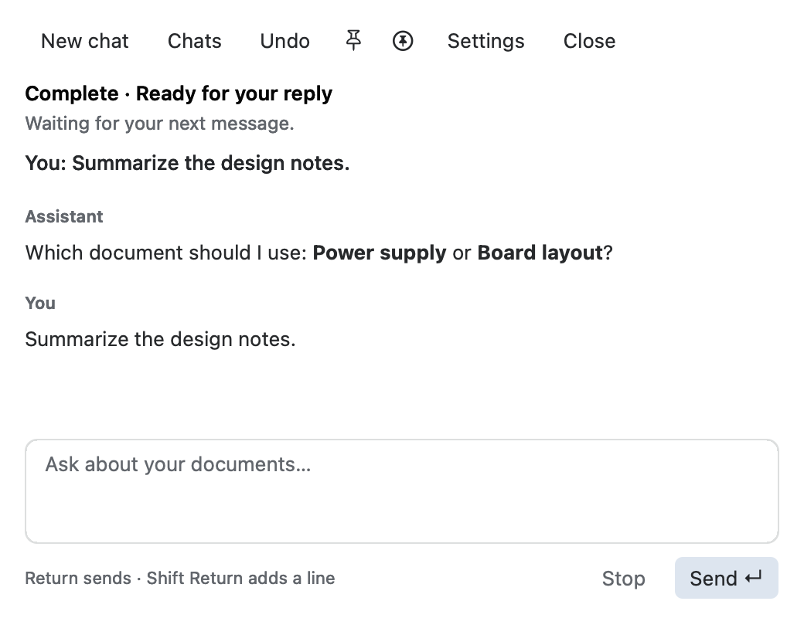
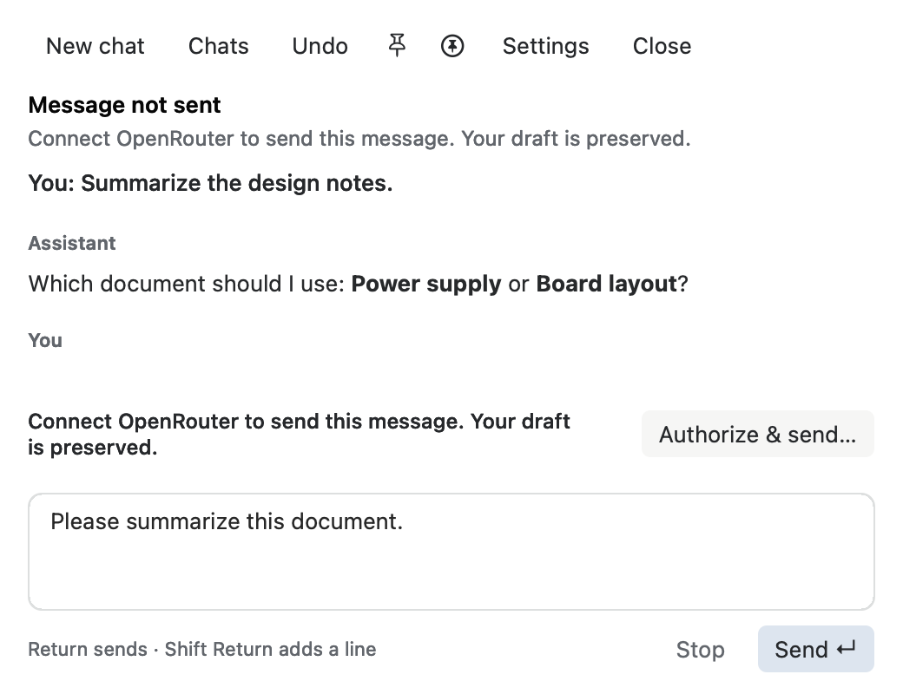
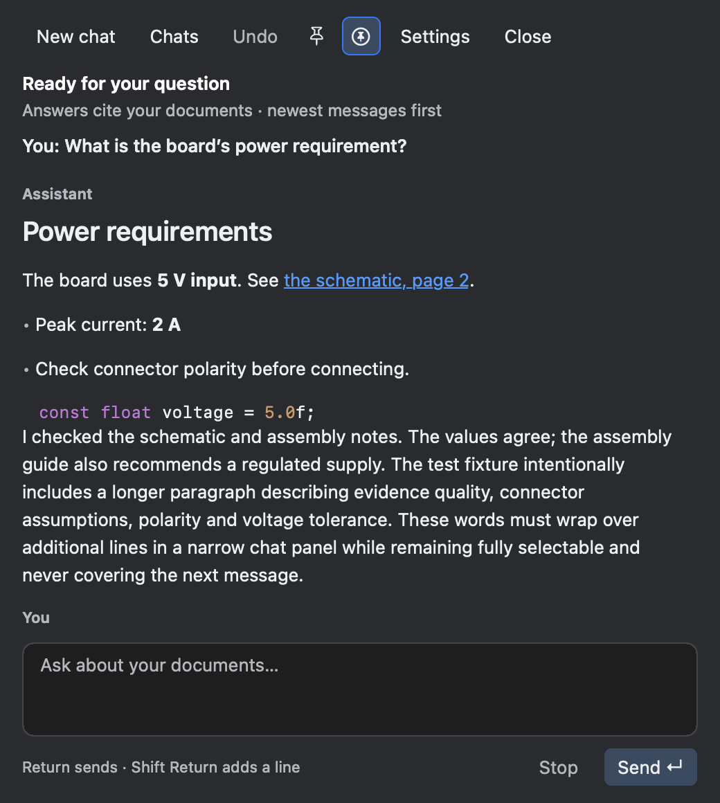

# Chat window UX review

10 October 2026. Independent review of the ChatView implementation and native light/dark render probes, with production-linked user-path tests. The reviewer implemented the separate window controller; its lifecycle tests are implementation evidence, not an independent review of that controller. No user app was launched, quit or captured.

**Reviewed interface grade: visual quality 9.0/10; usability 9.1/10. No major or medium improvements remain in the reviewed scope.**

The first review found excessive blank space between short transcript messages. The UI author removed the renderer's terminal blank paragraph and reduced excess padding; refreshed native probes show 16–20 pt separation and retain correct long-text wrapping. The final review checked 520 pt minimum-width question, thinking, failure and authorization states, plus normal-width light/dark views and selected pin modes. The error headline now asks the reader to review details rather than promising that every failure can be retried.

The header controls remain aligned and readable at minimum width. Pin symbols have different shapes, exclusive selected states, hover explanations and accessibility labels. The latest user question stays visible above the independently scrolling transcript. Source links are visibly distinguished and retain their exact document URLs. The authorization action is next to its explanatory message above the composer, and still fits the 520×400 pt minimum window without covering the draft or Send control.

## Ranked remaining notes

1. **Low:** the toolbar Close control duplicates the native red close button. It is harmless and accessible; a later cleanup could reclaim this width if another control is added.
2. **Low:** a submission failure repeats its explanation in the activity area and beside the recovery button. Keep the action-local explanation; the top line could be shorter to reduce repetition.

The source/citation tests prove provenance checks, cross-document navigation and PDF highlighting. Window tests prove separate native window identity, normal default ordering, app-only pin dropping on deactivation, all-app pin retaining floating level, persisted pin preference, close/reopen draft retention, File Close routing and keyboard submission. Native target tests check the recovery button's full inset hit rectangle. Live multi-application window switching remains outside this headless verification scope.

## Native evidence

Minimum-width question and reply:

Minimum-height authorization recovery and retained draft:

Dark appearance with all-applications pin selected:

