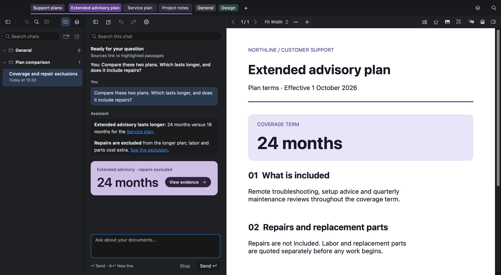
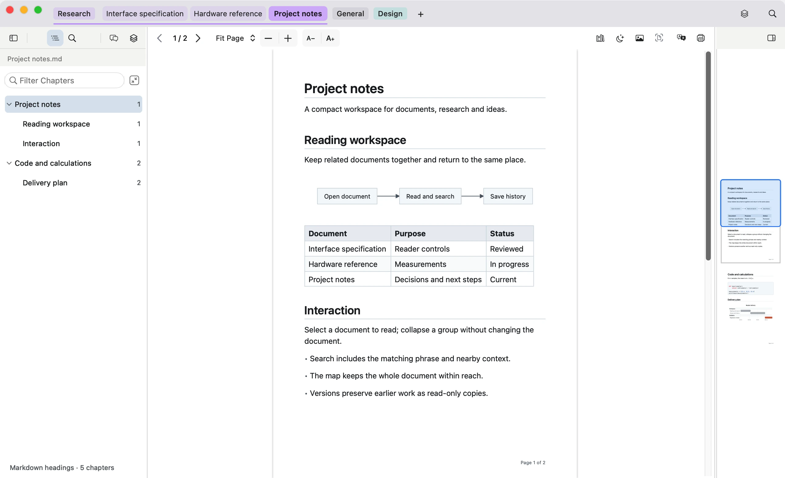
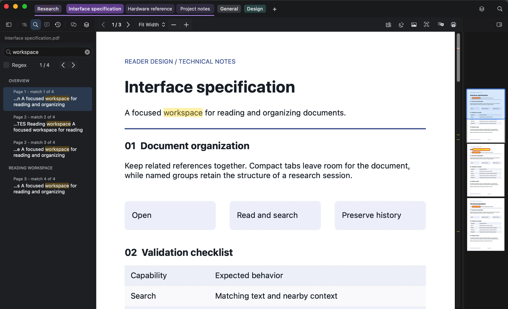
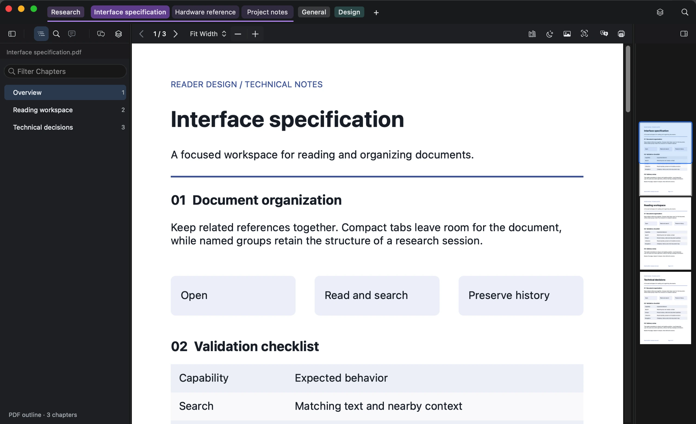

# Shenzhen PDF Reader

A fast, free, open-source reader for macOS. Organize documents in groups and keep them in Collection, your local document library. Search and AI help you find information, compare documents and check the sources.

Supports PDF, EPUB, Markdown, text, code and images.

**[Download for Mac](https://github.com/casimir-engineering/shenzhen-pdf/releases/latest/download/ShenzhenPDF-mac-arm64.dmg)** · Apple Silicon · macOS 12+ · Signed and notarized

Latest <b>26.10.11-1</b> · [Release notes](https://github.com/casimir-engineering/shenzhen-pdf/releases/latest) · [Website](https://casimir-engineering.github.io/shenzhen-pdf/) · [中文](https://casimir-engineering.github.io/shenzhen-pdf/zh/)

## Ask about your documents

- Ask questions across open documents. Click source links to open and highlight the cited passages.
- Brief answers can include a card with a **View evidence** button.
- Inspect page images, crops and the current document view with image-capable models.
- Generate summaries, up to six tags and missing chapters in your selected language.
- Save chats in folders; search, resume and rename them. Supported agent edits have Undo/Redo.

*Scripted UI example using fictional plans.*

Requires an OpenRouter account and credits. Retrieved content is sent to the provider. Chat and automatic analysis can be disabled separately. Models can misinterpret documents: verify the cited evidence. [AI guide](portable/docs/document-assistant.md) · [Six-model benchmark](portable/docs/journals/ai-reader/model-benchmark-2026-10-11.md)

## Markdown and code

Paginated Markdown with native vector diagrams, math, tables and syntax highlighting. Configurable paper size, margins and page breaks. External edits reload automatically. Text and code support font-size adjustment; HTML opens as source.

## Search and navigation

Type in the reader to search. Results include chapter context, page highlights and map markers. **⌘K** searches open documents and Collection; an empty palette lists recently viewed documents. The document map supports direct page navigation.

## Groups and Collection

- Colored tab groups, drag-and-drop organization and multiple windows.
- Restore tabs, groups, window positions, page, zoom and search state from YAML.
- Collection is your local document library, with saved copies and version history. Available copies remain editable when originals disappear.
- Compare revisions, reconnect missing originals, and set dynamic, fixed or unlimited storage.
- Identical content is deduplicated. Changed versions are full copies, without delta storage.

## Local tools

- **OCR:** searchable PDFs from scans and images using OCRmyPDF and Tesseract.
- **Translation:** selected text or documents using Argos Translate.
- **Images:** paste, rotate, save as image/PDF and copy as PDF.
- **Reading:** dark theme with per-document image-color settings, printing and PDF export.

OCR and translation run locally after their tools and language packs are downloaded. [Full feature list](docs/features.md)

## Automation and platforms

[CLI/MCP and Markdown authoring guide](portable/docs/agent-interface.md): open and inspect documents, organize saved groups while the app is closed, navigate/highlight content, and control Markdown layout.

- **macOS:** native AppKit app; signed Apple Silicon download above.
- **Linux:** GTK4 frontend; feature availability differs.
- **Windows:** native Win32 frontend; build from source, no published binary.

[Build instructions and architecture](portable/README.md) · [Benchmark runner](tools/ai-model-benchmark/README.md) · [Report an issue](https://github.com/casimir-engineering/shenzhen-pdf/issues)

## License

See [COPYING](COPYING), [COPYING.BSD](COPYING.BSD) and [NOTICE.md](NOTICE.md). Dependencies retain their own licenses. ShenzhenPDF is a separate project inspired by SumatraPDF, with no affiliation.
